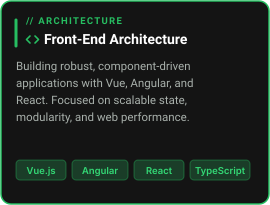
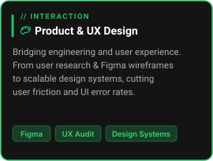
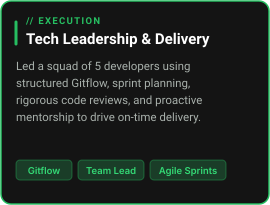
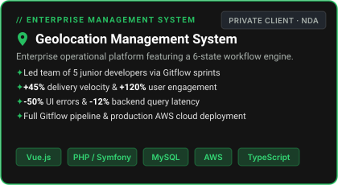
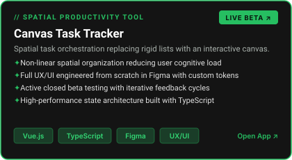
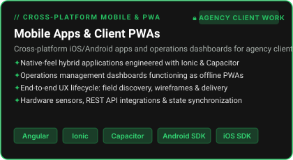
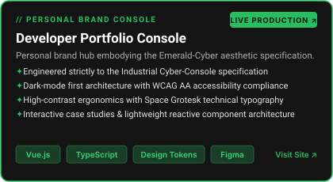

<!-- ======================================================= -->
<!-- HERO & HEADER SECTION                                   -->
<!-- ======================================================= -->
<div align="center">


# Carlos Victor Furtado
### `Full Stack Developer` · `Tech Lead` · `UX/UI & Product Design`

[](https://victorfurtyy.com)

<p align="center">
  <a href="https://victorfurtyy.com"></a>
  <a href="https://www.linkedin.com/in/victorfurtyy/"></a>
  <a href="mailto:carlos.dasilva@jala.university"></a>
  <a href="https://discordapp.com/users/victorfurtyy"></a>
</p>

<p align="center">
  <sub>🇧🇷 <b>Native Portuguese</b> &nbsp;·&nbsp; 🇺🇸 <b>Fluent English</b> &nbsp;·&nbsp; 🇪🇸 <b>Spanish</b></sub>
</p>

</div>

---

### `// 01. ABOUT ME`
## ◈ Overview

```
DEVELOPER PROFILE — Carlos Victor Furtado
───────────────────────────────────────────────────────────────────────
  Role        │  Full Stack Developer · Tech Lead
  Focus       │  Front-End Architecture · UX/UI · Scalable Systems
  Education   │  B.S. Software Engineering — Jala University (2023–2027)
  Location    │  Brazil 🇧🇷
  Status      │  Open to opportunities
───────────────────────────────────────────────────────────────────────
```

I am a **Full Stack Developer and Tech Lead with over 4 years of experience** architecting high-performance web and mobile systems for real-world clients. What sets me apart is the convergence of **technical depth** with **UX/UI & Product Design**, ensuring that every system is not only clean and performant under the hood, but intuitive and frictionless for users.

---

### `// 02. CORE STRENGTHS`
## ◈ What I Bring To The Team

<table>
  <tr>
    <td width="33%" valign="top"></td>
    <td width="33%" valign="top"></td>
    <td width="33%" valign="top"></td>
  </tr>
</table>

---

### `// 03. TECH STACK`
## ◈ Technologies & Tooling

<p><b>Frontend & Architecture</b></p>
<p>
  
  
  
  
  
  
</p>

<p><b>Backend & Cloud Infrastructure</b></p>
<p>
  
  
  
  
  
</p>

<p><b>Mobile & Cross-Platform</b></p>
<p>
  
  
  
  
  
</p>

<p><b>Product Design & Workflow</b></p>
<p>
  
  
  
  
</p>

---

### `// 04. FEATURED WORK`
## ◈ Featured Projects

<table>
  <tr>
    <td width="50%" valign="top">
      
    </td>
    <td width="50%" valign="top">
      <a href="https://canvas-task-tracker.victorfurtyy.com/" target="_blank">
        
      </a>
    </td>
  </tr>
  <tr>
    <td width="50%" valign="top">
      
    </td>
    <td width="50%" valign="top">
      <a href="https://victorfurtyy.com" target="_blank">
        
      </a>
    </td>
  </tr>
</table>

---

### `// 05. CODE METRICS`
## ◈ GitHub Analytics

<div align="center">


</div>

<div align="center">

[](https://github.com/victorfurtyy)

</div>

<div align="center">

[](https://github.com/victorfurtyy)

</div>

---

### `// 06. EDUCATION`
## ◈ Academic Background & Credentials

```
◆ B.S. Commercial Software Engineering          Jala University              2023 – 2027
  Emphasis: Software Design, Architecture & Distributed Systems

◆ B.S. Computer Science                         Centro Univ. União Américas  2023 – 2026
  Emphasis: Full Stack Web Engineering & Computing Fundamentals

◆ Professional Certification in UX/UI Design    Programa Trilhas             2024
  State Government of Maranhão — User Research, Interaction & Prototyping

◆ Professional IT Technician                    IFMA                         2018 – 2021
  Instituto Federal do Maranhão — Web Development & Networking
```

---

<div align="center">


### *"I build software people love to use."*

[](https://www.linkedin.com/in/victorfurtyy/)
[](mailto:carlos.dasilva@jala.university)

<br/>


</div>
